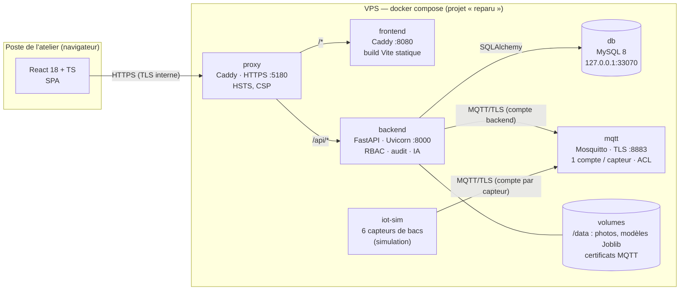
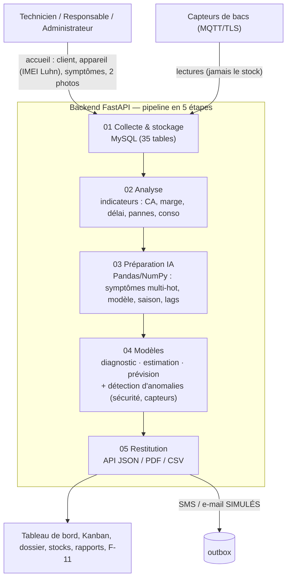

# Architecture

L'application suit une architecture 3-tiers (présentation React, métier FastAPI avec son pipeline d'IA, données MySQL), complétée par une chaîne IoT sécurisée. Le tout est déployé par Docker Compose sur un seul serveur.

> **Données de démonstration synthétiques.** Elles sont générées par `ml/data/generate.py` (graine fixe) ; aucune ne provient de l'atelier réel.

## 1. Vue de déploiement



| Service | Image | Exposition | Utilisateur | Rôle |
|---|---|---|---|---|
| `proxy` | `infra/proxy` (Caddy 2.8) | `5180` (HTTPS) | 1000 | Point d'entrée unique, TLS, en-têtes de sécurité |
| `frontend` | `frontend/` (Node 20 → Caddy) | interne | 1000 | Interface (SPA) |
| `backend` | `backend/Dockerfile` (Python 3.11) | `127.0.0.1:8010` | 1000 | API, règles métier, IA, client MQTT, tâches de fond |
| `db` | `mysql:8.0` | `127.0.0.1:33070` | mysql | Données |
| `mqtt` | `infra/mqtt` (Mosquitto 2) | `8883` (TLS) | mosquitto | Broker IoT |
| `iot-sim` | `iot-sim/` (Python 3.11) | — | 1000 | Simulateur de capteurs |
| `e2e` (profil `tests`) | `mcr.microsoft.com/playwright` | — | 1000 | Captures 1440 × 900 |

Au démarrage, le backend enchaîne quatre étapes : `alembic upgrade head` → seed (si la base est vide) → entraînement des modèles (s'ils sont absents) → Uvicorn. Un clone propre devient ainsi opérationnel en une commande (D-M9).

## 2. Flux de données

Ce schéma recrée celui du cahier des charges, absent du kit.



## 3. Backend

```
backend/app/
  api/        routes FastAPI : un module par domaine, chaque route protégée par require_role(...)
  core/       config, db (session), security (bcrypt, JWT), rbac (matrice unique), audit, middleware, clock
  models/     SQLAlchemy 2 (tables.py, enums.py) — voir docs/MCD.md
  schemas/    Pydantic v2 (entrée et sortie de chaque endpoint)
  services/   règles métier : regles, reparations, facturation, stocks, planning, pilotage, ia, iot, securite, rgpd, pdf, outbox…
  ml/         features, baselines, train (comparaison et sélection), anomalies, registry (chargement Joblib)
  seed.py     chargement des données synthétiques
  simulation.py  scénario d'attaque simulé (brute force)
```

- **Sécurité transverse.** `SecurityMiddleware` ajoute les en-têtes, limite le débit de `/auth` (un 429 est journalisé) et journalise toute écriture. `require_role` produit un 403 explicite et journalisé.
- **Règles métier.** Elles sont appliquées côté serveur et renvoient un 422 avec un message en français : Luhn, 2 photos avant diagnostic, devis tranché avant intervention, test de sortie avant « Prêt », encaissement avant restitution, mouvement de stock nominatif.
- **Tâches de fond** (désactivées dans les tests) :
  - le client MQTT publie les consignes et rapproche les lectures toutes les 30 s ;
  - la surveillance IA analyse le journal toutes les 60 s ;
  - la purge RGPD s'exécute une fois par jour.
- **Tests.** `docker compose run --rm backend pytest -q` lance 79 tests sur SQLite en mémoire, à partir d'une copie de la base synthétique. La couverture de `services/` dépasse 85 %.

## 4. Intelligence artificielle

| Modèle | Tâche | Candidats (en plus de la baseline) | Baseline naïve | Retenu (données synthétiques) |
|---|---|---|---|---|
| diagnostic | Top 3 pannes + pièces + confiance | LogisticRegression, RandomForest, GradientBoosting | Panne la plus fréquente par modèle d'appareil | LogisticRegression, top 3 97,7 % (baseline 77,7 %) |
| estimation | Durée réelle → prix (règle unique D-B3) | Ridge, RandomForest, GradientBoosting | Médiane par panne | Ridge, MAE 9,45 min (9,6) |
| prevision | Consommation hebdomadaire par pièce → quantité à commander | Moyenne mobile 30 j, Ridge sur retards, GradientBoosting sur retards | Semaine précédente | Moyenne mobile 30 j |
| securite | Fenêtres horaires du journal d'audit | IsolationForest, LocalOutlierFactor | ≥ 5 échecs/h | LOF, F1 0,93 |
| capteurs | Lectures atypiques | IsolationForest, LocalOutlierFactor | Variation relative ≥ 1 | IsolationForest, F1 0,69 |

L'évaluation se fait sur un découpage temporel. Le meilleur modèle est retenu automatiquement, versionné (`v1.x`) et sérialisé en Joblib dans `/data/models`. Ses métriques sont enregistrées en JSON et exposées par `GET /api/ia/fiabilite` (F-11, en bas de 5.11). Le rapport complet est dans `ml/reports/evaluation.md`.

## 5. IoT

- Chaque capteur est un client MQTT distinct, en TLS, avec son propre compte.
  - Il publie `reparu/capteurs/<id>/lecture`.
  - Il lit `reparu/capteurs/<id>/consigne` (stock comptable, publié en *retained* par le backend).
- Les ACL limitent chaque compte à ses propres topics.
- Le backend stocke la lecture, la rapproche du stock et ouvre une anomalie si besoin : écart persistant, valeur aberrante, capteur muet, lecture atypique (IA).
- La correction est toujours un mouvement humain, tracé et nominatif.

## 6. Frontend

```
frontend/src/
  api/         client Axios (jeton, 401), schema.d.ts généré depuis l'OpenAPI
  styles/      tokens.css : jetons oklch de la maquette, polices embarquées, règles du mode accessibilité
  components/  Shell (barre latérale, en-tête, recherche, cloche, enveloppe Ecran → Verrouillé),
               Etat (Loading / Empty / Error / Verrouillé), ui (pastilles, KPI, modale…), composants par groupe
  hooks/       useAuth (permissions), useApi (état d'écran), useA11y, useToast
  pages/       14 écrans de la maquette + 404
```

Les écarts avec la maquette sont listés dans `docs/ECARTS_MAQUETTE.md`.

## 7. Commandes

| Action | Commande |
|---|---|
| Lancer (clone propre) | `cp .env.example .env` (adapter les secrets) puis `docker compose up -d --build` → https://localhost:5180 |
| Tests backend | `docker compose run --rm backend pytest -q` |
| Captures visuelles | `docker compose --profile tests run --rm e2e` |
| Recharger les données de démo | `docker compose run --rm backend python -m app.seed --reset` |
| Réentraîner les modèles | Bouton F-11 (5.11), ou `docker compose exec backend python -m app.ml.train` |
| Simuler un brute force | `docker compose exec backend python -m app.simulation brute-force` |
| Sauvegarder / restaurer | `scripts/sauvegarde-mysql.sh` / `scripts/restauration-mysql.sh <fichier>` |
| Purge RGPD manuelle | `docker compose exec backend python -m app.services.rgpd` |
