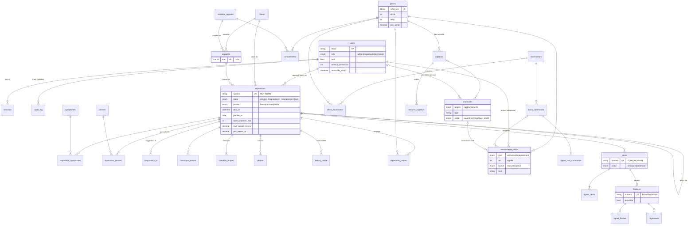

# Modèle de données (MCD)

- Moteur : MySQL 8, InnoDB, utf8mb4.
- Source de vérité : `backend/app/models/tables.py`. La migration initiale est `backend/alembic/versions/0001_schema_initial.py`.
- Le schéma compte 35 tables, plus `alembic_version`.

## Conventions
- Toutes les tables ont une clé `id` BIGINT auto-incrémentée, ainsi que `created_at` et `updated_at`.
- Les deux tables d'association `reparation_symptomes` et `compatibilites` font exception : elles ont une clé composite.
- Montants : `DECIMAL(10,2)`, en euros **HT**. Le TTC est calculé avec la TVA de la table `parametres`.
- Clés étrangères :
  - `RESTRICT` par défaut ;
  - `CASCADE` pour les dépendances fortes (checklist, photos, lignes…) ;
  - `SET NULL` pour les auteurs et les techniciens.
- Toutes les colonnes de date et toutes les clés étrangères sont indexées (exigence de performance < 3 s).
- Les statuts métier sont des `ENUM` MySQL. Les valeurs sont listées dans `backend/app/models/enums.py`.
- Le statut de stock (En stock / Seuil bas / Rupture) n'est pas stocké : il est calculé à partir de `stock` et `seuil`.

## Diagramme

## Tables hors diagramme
- `modeles_ia` : nom, version `v1.x`, algorithme retenu, métriques en JSON, chemin Joblib, nombre de lignes d'entraînement, `actif`. Cette table alimente F-11.
- `parametres` : couples clé / valeur. On y trouve `taux_horaire` = 45, `tva` = 0,20, `marge_visee` = 0,90, `capacite_jour_h` = 7, `seuil_charge` = 0,85, `sla_h` = 48 et `conservation_ans` = 3.
- `outbox` : SMS et e-mails simulés (canal, destinataire, corps, `programme_pour`, statut).

## Règles d'intégrité portées par le schéma
- Un appareil appartient obligatoirement à un client (FK non nulle).
- L'IMEI est unique ; sa validité (Luhn) est vérifiée par le service.
- Tout mouvement de stock a un auteur (`par_user_id` NOT NULL) et une source. Une lecture capteur ne modifie jamais `pieces.stock`.
- Les numéros `REP`, `DV`, `FA` et `BC` sont uniques.
